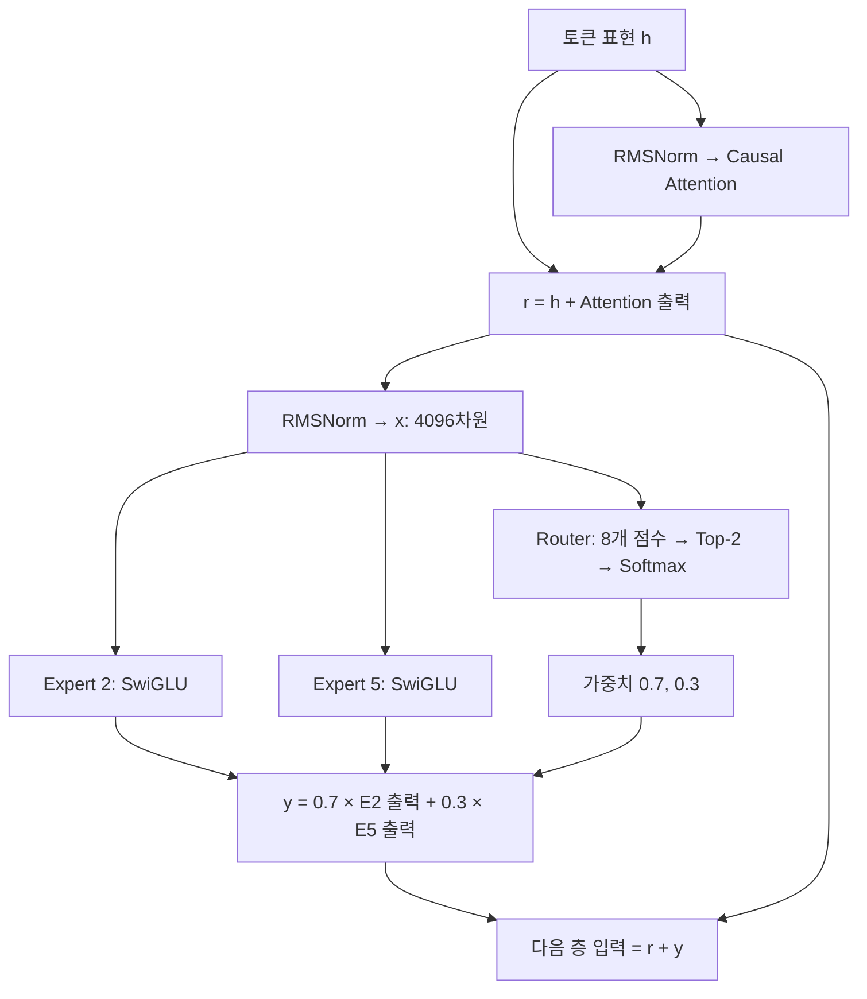

# 02주차 — Mixtral of Experts 읽기 기록

> **핵심:** 각 층·각 토큰마다 FFN 8개 중 2개를 선택해 가중합하며, 전체 약 46.7B 중 토큰당 약 12.9B를 활성화함.

| 항목 | 내용 |
| --- | --- |
| 언제 | 논문 최초 공개 2024-01-08, 확인한 arXiv 이력은 v1만 있음; 공식 모델 소개는 2023-12-11로 구분함 |
| Venue | 확인한 원문은 arXiv preprint임; 정식 학회·학술지 채택 정보는 확인 필요 |
| 저자·소속 | Albert Q. Jiang 외 25명 · Mistral AI, [전체 저자](https://arxiv.org/abs/2401.04088) |
| 논문·공식 코드 | [본문 v1](https://arxiv.org/html/2401.04088v1) · [공식 추론 구현](https://github.com/mistralai/mistral-inference) · [가중치·설정](https://huggingface.co/mistralai/Mixtral-8x7B-v0.1) |

📝 필사 정리 / 💭 제공된 내 생각·질문 / 🔎 추가 조사·GPT 해설 / ✅ 원문 대조·교정으로 구분함.
[필사 원문](notes-original.md)과 [Q&A 원문](qa-original.md)은 첨부 파일 그대로 보존함; 교정 전 설명도 남아 있으므로 아래 정리와 구분해 읽음.

## 1. 배경·공부 목적

📝 Dense 모델은 크게 만들수록 성능을 높일 여지가 있지만 매 토큰마다 모든 FFN을 실행하므로 계산 비용이 큼.
Mixtral은 **보유한 파라미터 수와 실제 계산하는 파라미터 수를 분리**하는 Sparse Mixture of Experts 모델임.
이번 필사는 “8×7B면 56B 아닌가?”에서 시작해, 토큰당 13B 계산·Top-2 가중합·긴 문맥·Expert의 실제 분업으로 질문이 이어졌음.

> 💭 **내 생각:** Expert가 실제로 어떻게 나뉘는지가 궁금함; 도메인보다 구문이나 토큰 수준에서 분업한다는 결과가 매우 흥미로움.

> 🔎 **GPT의 해설:** MoE는 여러 Expert 출력을 조합하는 넓은 개념이고, Sparse MoE는 그중 일부만 실행하는 방식임; Expert 내부 가중치 대부분이 0이라는 뜻은 아님.

## 2. Gap

📝 기존 MoE의 모델 용량 확장 효과를 실제로 활용하려면 라우팅·통신·학습 안정성과 효율적인 실행을 함께 다뤄야 함.
Mixtral은 GShard와 비슷한 Top-2 계열 구조를 Decoder-only 모델의 모든 FFN에 적용하고 공개 가중치와 실행 지원을 제공함.

**[저자의 주장]** 공개 모델 가운데 최고 수준 성능에 도달한 첫 MoE라고 서술함.

> ✅ **필사 보완:** “가장 단순한 MoE를 처음 구현함”이나 “이후 오픈 MoE가 모두 여기서 출발함”까지 입증한 것은 아님; Top-2 자체의 발명보다 강한 공개 모델과 활용 가능한 실행 스택을 제공한 의미로 읽음.

근거: [Mixtral §1·2.1·6](https://arxiv.org/html/2401.04088v1).

## 3. 핵심 아이디어·구조와 수식

### 3.1 8×7B인데 왜 56B가 아닌가?

> 💭 **내 질문:** 7B Expert 8개면 56B 아닌가; 2개를 쓰면 왜 14B가 아니라 13B인가?

📝 Expert는 완전한 7B 모델이 아니라 **한 층의 FFN 하나**임.
32개 층 각각에 별도의 Expert 8개와 Router가 있으며, Attention·임베딩 등은 공유함.
전체 FFN은 256개이고 같은 번호라도 층이 다르면 다른 가중치임.

| 설정 | 값 |
| --- | ---: |
| 층 수 / Hidden 차원 | 32 / 4,096 |
| Expert FFN 내부 차원 | 14,336 |
| 층당 Expert / 토큰당 선택 | 8 / 2 |
| Query Head / KV Head | 32 / 8 |
| 문맥 길이 | 32,768 |

🔎 공개 구조에서 계산한 Expert 하나의 세 가중치 행렬 크기는 다음과 같음.

```math
P_{\mathrm{expert}}=3\times4096\times14336=176{,}160{,}768
```

| 구성 | 전체 파라미터 | 토큰당 활성 파라미터 |
| --- | ---: | ---: |
| Attention·임베딩·출력층 등 공유 부분 | 약 1.6B | 약 1.6B |
| 32개 층의 Expert FFN | 32 × 8 × 약 0.176B | 32 × 2 × 약 0.176B |
| 합계 | 약 46.7B | 약 12.9B |

근삿값이며 B는 10억임; 다른 토큰이 다른 Expert를 선택하므로 전체 가중치를 보관해야 함.
근거: [공식 소개](https://mistral.ai/news/mixtral-of-experts/) · [논문 Table 1](https://arxiv.org/html/2401.04088v1) · [공식 config](https://huggingface.co/mistralai/Mixtral-8x7B-v0.1/blob/main/config.json).

#### 추가 스터디 — 14,336과 SwiGLU의 세 행렬

**Q:** `3 × 4096 × 14336`에서 14,336은 무엇이며 왜 하필 이 값임?

**A:** Expert FFN 안에서 표현을 확장하는 중간 차원이며, 모델 차원 4,096과 달리 FFN 내부에서만 사용하는 너비임.

예를 들어 토큰 하나의 4,096차원 벡터를 두 갈래로 각각 14,336차원으로 확장하고, 한 갈래에 SiLU를 적용해 다른 갈래와 곱한 뒤 다시 4,096차원으로 줄임.

| 행렬 | 역할 | 열벡터 연산의 행렬 크기 |
| --- | --- | --- |
| W₁, Gate | 4,096 → 14,336, 이후 SiLU | 14,336 × 4,096 |
| W₃, Up | 4,096 → 14,336 | 14,336 × 4,096 |
| W₂, Down | 14,336 → 4,096 | 4,096 × 14,336 |

세 행렬 모두 원소 수가 같으므로 `3 × 4096 × 14336`임.
사용자 Q&A의 표는 입출력 차원을 나열한 것으로 읽을 수 있지만, 행렬의 실제 Shape는 행벡터·열벡터 표기에 따라 전치됨.

🔎 **왜 3.5배인가:** 14,336은 4,096의 3.5배임.
두 행렬을 쓰는 일반 FFN의 너비를 `4d`로 두고 파라미터 수를 맞추면, 세 행렬의 SwiGLU는 `m=(2/3)×4d`가 됨.
이는 **동일 예산 비교를 위한 계산이지 SwiGLU의 필수 너비 규칙이 아님**.
Mistral/Mixtral의 실제 값은 더 넓은 `3.5d`이며, 논문은 그 값을 택한 구체적인 탐색·성능 근거까지 밝히지 않음.
“1024의 배수여서 GPU에 유리함”은 정렬 가능한 크기라는 관찰이며, 해당 선택의 실측 이점·저자 동기로 단정하지 않음.

**Q:** SwiGLU는 LLaMA나 Llama 2에서 시작했음?

**A:** 2020년 Noam Shazeer의 GLU 변형 연구에서 제안됐고, LLaMA 1이 이미 채택했으므로 Llama 2가 시작은 아님.

GLU는 한 갈래가 다른 갈래를 원소별로 조절하는 Gate 구조임.
SwiGLU는 Gate 쪽에 Swish를 사용하며, 여기서 쓰는 `Swish₁(z)=SiLU(z)=z·sigmoid(z)`임.
위 식의 바깥 W₂까지 포함한 것이 Transformer의 전체 FFN임.
MoE의 **Router Gate는 Expert 사이의 선택·비율**, SwiGLU의 **Gate는 Expert 내부 특징별 조절**이라는 차이가 있음.

근거: [GLU Variants Improve Transformer, 식 (5)–(6)](https://arxiv.org/html/2002.05202) · [LLaMA §2.2](https://arxiv.org/html/2302.13971) · [Mixtral Table 1](https://arxiv.org/html/2401.04088v1).

#### 47B / 13B 직접 검산

🔎 공개 설정을 이용한 GPT의 계산이며 작은 Norm·Router 항은 아래 근삿값에서 생략함.

| 항목 | 계산 | 결과 |
| --- | --- | ---: |
| 전체 Expert FFN | 176,160,768 × 8 × 32 | 약 45.10B |
| 활성 Expert FFN | 176,160,768 × 2 × 32 | 약 11.27B |
| Attention | 4096 × (4096 + 1024 + 1024 + 4096) × 32 | 약 1.34B |
| 입력 임베딩 + 출력층 | 32000 × 4096 × 2 | 약 0.26B |
| 전체 합계 | 45.10 + 1.34 + 0.26 | 약 46.70B |
| 활성 합계 | 11.27 + 1.34 + 0.26 | 약 12.88B |

K·V 출력 차원이 1,024인 이유는 KV Head 8개 × Head Dimension 128이기 때문임.
46.7B/12.9B는 논문의 47B/13B 반올림과 맞음.
활성 수는 모델 비교에 쓰는 가중치 집계 관례이며, 임베딩 테이블의 모든 행을 토큰 하나가 곱한다거나 이 숫자만큼의 FLOPs가 발생한다는 뜻은 아님.

### 3.2 Router → 두 Expert → 가중합

> 💭 **내 질문:** 토큰마다 실행되는 파이프라인이 궁금함; 구현 수준으로 그려 보면 좋겠음.

📝 현재 토큰 표현으로 8개 Logit, 즉 정규화 전 점수를 구하고 Top-2를 선택함.
같은 입력을 두 Expert가 각각 처리한 뒤 선택된 점수의 Softmax 가중치로 출력을 합함.



🔎 Expert 번호와 가중치는 설명용임; 실제로는 선택된 Expert에만 입력을 보내며 같은 Expert의 토큰을 묶어 계산함.
행벡터 표기에서 `x`는 `d`, `W_g`는 `d×8`임.

```math
\ell=xW_g,\qquad
G(x)=\operatorname{Softmax}(\operatorname{Top2}(\ell)),\qquad
y=\sum_{i=0}^{7}G_i(x)E_i(x)
```

> 💭 **내 질문:** 선택되지 않은 Logit을 왜 음의 무한대로 두며, 기존 MoE도 이렇게 했는가?

> 🔎 **GPT의 해설:** 지수화하면 0이 되어 Softmax에서 제외되기 때문임; 단순히 Logit을 0으로 두면 양의 확률이 남음; Top-k는 [2017 MoE](https://arxiv.org/abs/1701.06538)에도 있지만 Noise·정규화·두 번째 Expert 선택 방식은 구현마다 다름.

Expert는 비선형 함수 SiLU와 원소별 곱을 쓰는 SwiGLU임; 아래는 열벡터 표기로 풀어 쓴 Expert 식임.

```math
E_i(x)=W_{2,i}\left[\operatorname{SiLU}(W_{1,i}x)\odot(W_{3,i}x)\right]
```

> 💭 **내 질문:** FFN은 비선형 변환이 맞는가; Figure 1의 Gate 전달 선은 Residual인가?

> 🔎 **GPT의 해설:** FFN은 문맥이 반영된 토큰 특징을 비선형으로 조합함; Gate 전달 선은 Expert 출력에 곱할 계수이며, 원래 표현을 더하는 Residual과 별개임.

```python
# GPT 설명용 의사코드: 한 토큰, 배치·최적화는 생략함.
scores = router(x)                    # [8]
top_scores, ids = scores.topk(k=2)
weights = softmax(top_scores, dim=-1)  # 선택된 두 개 안에서 정규화
out_0 = experts[ids[0]](x)
out_1 = experts[ids[1]](x)
y = weights[0] * out_0 + weights[1] * out_1
```

📝 Additively는 같은 크기 출력의 가중합이며 순차 실행이나 Concatenation이 아님.
선택 Expert는 다음 토큰·다음 층에서 달라질 수 있음.
Expert 수를 늘리고 `K=2`를 유지하면 토큰당 FFN 계산량 증가를 억제할 수 있지만 Router·통신·메모리 부담까지 고정되지는 않음.
근거: [Mixtral §2.1·Figure 1](https://arxiv.org/html/2401.04088v1).

#### 추가 스터디 — 왜 나머지 Logit을 버리고 다시 정규화하는가?

**Q:** MoE Top-2에서 나머지를 음의 무한대로 두고 두 개 안에서 확률 합을 1로 만드는 이유는?

**A:** 선택되지 않은 Expert의 가중치를 0으로 만들어 FFN 계산을 생략하고, 선택된 둘의 상대적인 비율로 출력을 결합하기 위함임.

“두 Expert가 각각 100%”가 아니라 **둘의 합이 100%**임.
Gate 가중치가 남은 Expert까지 포함해 출력의 정확한 가중합을 구하려면 그 Expert의 출력도 필요함.
선택되지 않은 Logit을 음의 무한대로 두면 그 지수값이 0이 되므로 제외할 수 있음.
이는 Expert FFN을 생략하는 것이며 **처음 8개 Router 점수 계산까지 생략하는 것은 아님**.

전체 Softmax 확률을 `p`, 선택된 Expert를 `a,b`라 두면 다음이 성립함.

```math
\widetilde p_a=\frac{e^{\ell_a}}{e^{\ell_a}+e^{\ell_b}}
=\frac{p_a}{p_a+p_b},\qquad
p_i=\frac{e^{\ell_i}}{\sum_j e^{\ell_j}}
```

따라서 **Top-2 Logit → Softmax**와 **전체 Softmax → Top-2 → 재정규화**는 같은 선택 집합에서 수학적으로 같음.
예를 들어 전체 확률이 `a=0.18, b=0.12, 나머지 합=0.70`이고 나머지 각각이 0.12보다 작으면 최종 비율은 `0.6, 0.4`임.
재정규화하지 않으면 두 Expert의 Gate 합이 0.30인 채 남아 전체 분포의 선택 질량이 출력에 곱해짐.
재정규화는 그 크기 변동 요인 하나를 없애지만 Expert 출력의 Norm·상쇄까지 일정하게 보장하지는 않음.

> 🔎 **GPT의 해석:** 전체 확률에서 두 Expert가 차지한 질량 정보는 사라지므로 재정규화는 설계 선택임; 이 질량을 보정된 “절대 확신도”로 해석할 근거도 없음; [Qwen2MoE의 `norm_topk_prob`](https://huggingface.co/docs/transformers/model_doc/qwen2_moe)는 재정규화 여부를 별도로 설정하는 예임.

**Q:** 나머지 Expert의 Logit은 그럼 아무 데도 쓰이지 않음?

**A:** 전체 점수는 Top-2의 순위를 결정하는 데 쓰이고, 전체 확률을 이용하는 부하 균형 손실이 있다면 그 경로로도 학습에 관여함.

선택 집합이 고정된 Mixtral 식의 주 손실에서는 비선택 Logit에 대한 직접 미분이 0임.
다만 공유되는 Router 가중치·입력 표현이 학습되므로 “그 Expert가 영원히 학습되지 않음”이라는 뜻은 아님.
해당 토큰에서 실행하지 않은 Expert FFN 가중치에는 그 FFN 경로의 주 손실 Gradient가 가지 않지만 다른 토큰이 선택하면 학습됨.
[Switch의 보조 손실](https://arxiv.org/html/2101.03961v3)은 전체 Router 확률을 사용함; Switch Top-1은 전체 Softmax의 선택 확률을 그대로 곱하므로 Mixtral의 재정규화된 Top-2와 Gradient 경로도 같지 않음.
Mixtral 보고서는 보조 손실 사용·계수를 구체적으로 밝히지 않으므로 사용했다고 채워 넣지 않음.

#### 디코딩 Top-k와 닮았지만 다른 점

**Q:** 출력 토큰을 Top-k Sampling할 때도 Softmax 전에 잘라냄?

**A:** Top-k 밖의 Logit을 음의 무한대로 가린 뒤 Softmax와 Sampling을 할 수 있으며, 전체 Softmax 후 같은 후보만 남겨 재정규화하는 것과 수학적으로 같음.

| 구분 | MoE Top-2 | 디코딩 Top-k Sampling |
| --- | --- | --- |
| 고르는 대상 | Expert | 어휘의 다음 토큰 후보 |
| 목적 | 토큰당 FFN 계산량 제한 | 샘플링 후보의 꼬리 제한 |
| 남은 값의 사용 | 두 출력의 가중합 | 분포에서 토큰 하나 추출 |
| 무작위성 | 같은 입력·가중치에서는 보통 결정적 선택 | `do_sample=True`이면 확률적 추출 |

Top-p는 **누적 확률**로 후보를 정하므로 그 판단 과정에도 Softmax가 필요함.
확인한 Transformers v4.45.2의 일반 Sampling 경로는 Temperature→Top-k→Top-p→최종 Softmax→Sampling임.
Top-p 내부의 누적 확률 계산과 마지막 Sampling용 정규화는 서로 다른 단계이며, 모든 라이브러리·설정의 보편 순서라고 단정하지 않음.
Top-k의 경계 동점 처리로 실제 후보 수가 k보다 많아질 수도 있음.

근거: [Mixtral §2.1](https://arxiv.org/html/2401.04088v1) · [Transformers v4.45.2 필터 구현](https://github.com/huggingface/transformers/blob/v4.45.2/src/transformers/generation/logits_process.py) · [적용 순서와 Sampling](https://github.com/huggingface/transformers/blob/v4.45.2/src/transformers/generation/utils.py).

### 3.3 Decoder-only·32K·Full Attention

📝 별도 Encoder 없이 앞선 토큰을 보고 다음 토큰을 예측함.
32K 다국어 문맥으로 사전학습했으며, Mistral 7B의 Sliding Window와 달리 32K 안의 과거 위치 전체에 직접 접근하는 **Causal Full Attention**을 사용함.

> 💭 **내 질문:** 어차피 Next-token Prediction인데 Context Size가 왜 중요한가; 입력은 마스킹하고 답만 학습하는가?

> 🔎 **GPT의 해설:** 예측 목표와 참고할 수 있는 앞 문맥 길이는 별개임; 일반적인 사전학습은 각 위치의 다음 토큰을 병렬 예측하면서 Attention Mask로 미래를 가리고, SFT의 Prompt Loss Mask는 질문을 입력에서 숨기는 대신 Loss 계산에서만 제외하는 방식임.

> 💭 **내 생각·질문:** MoE로 FFN 부담을 줄여 Attention을 Dense로 되돌렸을까; FlashAttention 등장도 영향을 줬을 것 같음.

> ✅ **사실·추측 구분:** Full Attention을 쓴다는 사실과 별개로 위 설계 동기는 내 추측임; Passkey 검색 100%가 Full Attention만의 효과라는 통제 실험도 없음.

🔎 Mistral 7B의 Window는 4,096이며 Rolling KV Buffer를 사용함.
32층 × 4,096 ≈ 131K는 이론적 정보 전달 범위이지 먼 토큰을 직접 보거나 그 길이에서 정확히 검색한다는 보장이 아님.
Mixtral의 GQA는 32개 Query Head가 8개 KV Head를 공유해 KV Cache 부담을 줄이는 데 도움됨.
Attention의 Dense와 FFN의 Sparse는 서로 다른 개념임.
근거: [Mixtral §2·Table 1](https://arxiv.org/html/2401.04088v1) · [Mistral 7B §2](https://arxiv.org/html/2310.06825).

### 3.4 Batch·EP·TP·실행 스택

> 💭 **내 질문:** 작은 Batch의 빠른 추론과 큰 Batch의 높은 Throughput을 왜 구분하는가?

🔎 Decode에서 작은 Batch는 가중치를 읽는 메모리 대역폭이, 큰 Batch는 가중치 재사용과 GPU 계산 활용률이 중요해질 수 있음.
Latency는 한 요청의 지연, Throughput은 전체 요청의 단위 시간당 처리량임.
Batch 전체에서 Expert 8개가 쓰여도 토큰마다 실행하는 것은 2개이며, 실제 속도는 통신·KV Cache·커널·하드웨어에도 좌우됨.

> 💭 **내 질문:** EP와 TP의 차이·사용 시점은 무엇이며 부하 분산은 왜 필요한가?

| 방식 | 나누는 것 | 실행 시 필요한 일 |
| --- | --- | --- |
| Expert Parallelism, EP | 서로 다른 Expert 가중치 | 해당 GPU로 토큰을 보내고 결과를 돌려받음 |
| Tensor Parallelism, TP | 한 연산의 가중치 행렬·계산 | GPU별 부분 결과를 통신으로 결합함 |

🔎 Expert 집합을 나눠 보관하려면 EP, 한 Expert·Attention 등의 큰 행렬을 나누려면 TP를 고려할 수 있고 함께 쓸 수도 있음.
특정 GPU의 Expert에 토큰이 몰리면 다른 GPU가 먼저 끝나도 기다리므로 부하 균형이 중요함.

📝 MegaBlocks는 Expert별 가변 토큰 수를 Block-sparse 행렬 연산으로 처리하는 시스템임.
CUDA Kernel은 GPU 스레드들이 병렬 실행하는 계산 함수이며, MoE 연산은 토큰 분배→Expert FFN→결과 결합을 포함함.

> ✅ **필사 교정:** Switch Capacity는 주로 TPU/XLA 기반 학습의 정적 버퍼 맥락이며 서빙 편의만으로 설명하지 않음; MegaBlocks는 Drop 없는 실행을 제시하지만 **Mixtral 사전학습의 Capacity·Token Drop 정책은 보고서에서 확인되지 않아 “Mixtral은 학습에서도 Drop하지 않음”은 확인 필요**임.

📝 논문은 관련 커널을 활용한 vLLM 통합 변경 제출을 설명함.
vLLM은 추론·서빙 엔진, SkyPilot은 클라우드 자원 준비·실행 관리 도구, Endpoint는 요청을 받는 API 주소임.

> 🔎 **GPT의 해설:** Submitted는 변경을 기여했다는 뜻이며 당시 PR의 정확한 수정 파일·병합 완료까지 뜻하지 않음; Any Instance도 지원 환경과 충분한 GPU 메모리 등의 조건이 전제임.

근거: [Mixtral §1·2.1·3](https://arxiv.org/html/2401.04088v1) · [MegaBlocks](https://arxiv.org/abs/2211.15841) · [Switch §2.2](https://arxiv.org/html/2101.03961v3) · [vLLM–SkyPilot 공식 연동](https://docs.vllm.ai/en/stable/deployment/frameworks/skypilot/); Batch·TP 설명은 GPT의 보충 해설임.

### 3.5 SFT → DPO

📝 Mixtral-Instruct는 지시 데이터로 SFT한 뒤 선호·비선호 답변 쌍으로 DPO함.
전체 데이터·학습 설정은 재현에 충분하게 공개되지 않았으므로 아래는 **GPT의 표준 구현 해설**임.

| 단계 | 입력 | 목표 |
| --- | --- | --- |
| SFT | 질문 + 모범 답변 | 모범 답변의 다음 토큰 확률을 높임 |
| DPO | 같은 질문의 Chosen / Rejected | 고정 Reference 대비 Chosen의 상대적 확률을 높임 |

```python
# 설명용 SFT: Causal LM이 내부에서 labels를 한 칸 shift한다고 가정함.
optimizer.zero_grad()
labels = input_ids.clone()
labels[:, :prompt_length] = -100  # 이 예시는 응답에만 Loss를 줌.
loss = model(input_ids=input_ids, labels=labels).loss
loss.backward()
optimizer.step()
```

질문은 Loss에서 제외해도 답변 예측의 입력으로 사용함; 학습 중 정답 답변의 앞부분도 보며 매번 답변을 자유 생성해 채점하는 방식이 아님.

```math
\mathcal{L}_{\mathrm{DPO}}=-\mathbb{E}_{(x,y_w,y_l)}\log\sigma\!\left(\beta\left[
\log\frac{\pi_\theta(y_w\mid x)}{\pi_{\mathrm{ref}}(y_w\mid x)}-
\log\frac{\pi_\theta(y_l\mid x)}{\pi_{\mathrm{ref}}(y_l\mid x)}\right]\right)
```

`x`는 질문, `y_w/y_l`은 선호/비선호 답변, `β`는 조절 계수, `σ`는 Sigmoid임.
답변 로그확률은 답변 토큰들의 조건부 로그확률 합임.

```python
# 개념적 DPO: reference는 고정하고 logp_ref는 gradient 없이 구함.
optimizer.zero_grad()
policy_gap = logp_policy_chosen - logp_policy_rejected
ref_gap = logp_ref_chosen - logp_ref_rejected
loss = -logsigmoid(beta * (policy_gap - ref_gap)).mean()
loss.backward()
optimizer.step()  # policy만 업데이트함.
```

별도 Reward Model이나 매 Step 새 답변 생성은 필요하지 않음.
근거: [Mixtral §4](https://arxiv.org/html/2401.04088v1) · [DPO §4·식 (7)](https://arxiv.org/html/2305.18290v2).

<a id="training-history"></a>

### 추가 스터디 — GPT-1에서 Mixtral까지 학습·평가의 흐름

> 💭 **내 질문:** GPT-1 때는 태스크마다 SFT하고 평가해서 레시피가 복잡했다고 함; 모델 크기는 어느 정도였고, Mixtral 무렵인 2024년부터 Instruction Tuning만 하는 흐름이 확립됐는지 궁금함.

🔎 **GPT의 해설:** GPT-1의 핵심은 복잡한 태스크별 구조를 줄이는 공통 사전학습이었지만, 평가할 태스크별로 라벨 데이터와 입력 변환·분류 목적을 이용해 따로 Fine-tuning했음.
오늘날의 “대화형 응답을 따라 쓰는 SFT”와 그때의 모든 지도 Fine-tuning을 같은 방식으로 보면 흐름이 헷갈림.

| 시기·예 | 규모·학습/평가 방식 | 바뀐 점 |
| --- | --- | --- |
| 2018 GPT-1 | 약 117M, 12층·Hidden 768·Context 512; 사전학습 후 태스크별 지도 Fine-tuning | 공통 모델을 출발점으로 쓰되 NLI·분류·선택형 QA 등은 각각 적응함 |
| 2019 GPT-2 | 최대 약 1.5B; 태스크별 파라미터 갱신 없이 Zero-shot 평가 | 프롬프트·텍스트 완성으로 작업을 수행할 가능성을 탐색함 |
| 2020 GPT-3 | 최대 175B; Zero/One/Few-shot 평가에서 Gradient Update 없음 | 예시를 입력에 제공하는 In-context Learning과 Fine-tuning을 구분함 |
| 2021 FLAN | 137B 모델에 60개 넘는 태스크의 지시문을 섞어 학습 | Instruction Tuning이 2024년에 처음 생긴 것이 아님 |
| 2022 InstructGPT | SFT→선호 데이터의 Reward Model→PPO | 지시 수행 학습에 사람의 선호 최적화를 결합함 |
| 2023 공개·2024 보고서 Mixtral-Instruct | SFT→DPO | Instruction Tuning 뒤에도 선호 학습이 있으므로 “Inst Tuning만 함”이 아님 |

GPT-1의 117M은 약 1.17억이며 GPT-3 175B와는 약 1,500배 차이임; 규모만으로 학습 방식의 변화 원인을 모두 설명하지는 못함.
Mixtral의 Base 벤치마크와 Instruct 평가는 구분해야 함.
Base 평가는 0-shot·Few-shot 프롬프트로 수행할 수 있고, Instruct는 미리 여러 지시 데이터·선호로 학습한 체크포인트를 평가함.
**평가용 Few-shot 예시를 입력하는 것과 평가 태스크마다 모델 가중치를 다시 Fine-tuning하는 것은 다름.**

태스크별 Fine-tuning이 사라졌거나 2024년부터 하나의 레시피만 남았다는 결론은 아님.
흐름의 핵심은 **태스크마다 별도 적응하던 평가 → 큰 공통 모델의 프롬프트 기반 평가 → 여러 지시·선호를 학습한 범용 모델**로 선택지가 넓어진 것임.

근거: [GPT-1 §3–4](https://cdn.openai.com/research-covers/language-unsupervised/language_understanding_paper.pdf) · [GPT-2 §2.3·Table 2](https://cdn.openai.com/better-language-models/language_models_are_unsupervised_multitask_learners.pdf) · [GPT-3](https://arxiv.org/abs/2005.14165) · [FLAN](https://arxiv.org/abs/2109.01652) · [InstructGPT](https://arxiv.org/abs/2203.02155) · [Mixtral §4](https://arxiv.org/html/2401.04088v1).

## 4. 실험 결과

### 4.1 Base 모델 — 수학·코드·다국어

아래는 **Table 2의 Base 모델**, 저자 평가 파이프라인 결과임.

| 지표·조건 | Llama 2 70B | Mixtral 8×7B |
| --- | ---: | ---: |
| 활성 파라미터 | 70B | 약 13B |
| MMLU, 5-shot | 69.9% | 70.6% |
| HumanEval, 0-shot | 29.3% | 40.2% |
| MBPP, 3-shot·검증된 부분집합 | 49.8% | 60.7% |
| MATH, 4-shot·maj@4 | 13.8% | 28.4% |
| GSM8K, 8-shot·maj@8 | 69.6% | 74.4% |
| HellaSwag, 0-shot | 85.4% | 84.4% |

`maj@k`는 k개 답에서 다수결로 선택하는 평가임.
Table 3의 GSM8K는 5-shot으로 조건이 달라 58.4%이므로 위 수치와 섞지 않음.
Table 4의 프랑스어·독일어·스페인어·이탈리아어 평가도 Llama 2 70B보다 높았음.

> ✅ **필사 보완:** 대부분의 지표에서 앞서거나 비슷하다는 결과이며, HellaSwag·WinoGrande·TriviaQA처럼 낮은 항목도 있음; 활성 파라미터가 약 5배 적다는 사실을 모든 환경에서의 5배 속도 향상으로 읽지 않음.

근거: [Mixtral §3·Table 2–4](https://arxiv.org/html/2401.04088v1).

### 4.2 Instruct — 사람 평가와 자동 평가

> 💭 **내 질문:** Human Benchmark는 사람이 평가했단 뜻인가; 오픈 모델이 클로즈드 모델을 넘던 시절도 있었는데 지금 격차는 GPU와 크기 때문인가?

| 평가 | Mixtral-Instruct | 비교·조건 |
| --- | ---: | --- |
| MT-Bench | 8.30 | GPT-3.5-Turbo-1106 8.32, LLM Judge 기반 다중 턴 평가 |
| Arena Elo | 1121 | 2023-12-22 스냅샷: Claude 2.1·최고 GPT-3.5 1117, Gemini Pro 1111, Llama 2 70B Chat 1077 |

🔎 Arena는 사람이 익명 답변 쌍을 비교하는 선호 평가임; HumanEval은 코드 실행 평가임.
근소한 Elo 차이를 모든 작업에서의 확정적 우위로 읽지 않음.

> 🔎 **GPT의 해설:** GPT-3.5와의 비교는 GPT-4까지 넘었다는 뜻이 아니며, 격차를 GPU·규모 하나로 확정할 근거도 부족함; 데이터·후학습·추론 계산량도 함께 봐야 함; [DeepSeek-R1](https://arxiv.org/abs/2501.12948)의 특정 추론 과제 비교도 “오픈 모델은 이제 불가능함”이라는 일반화를 경계할 사례이지 현재 전체 순위는 아님.

근거: [Mixtral §4·Table 3·Figure 6](https://arxiv.org/html/2401.04088v1).

### 4.3 긴 문맥 — 들어가는 길이와 활용 능력

📝 Figure 4는 시험한 문맥 길이·Passkey 위치에서 검색 정확도 100%를 보고함.
Proof-pile 부분집합에서는 문맥이 길어질수록 Perplexity가 낮아짐.
Sequence Length는 입력 전체 길이, Location은 근거가 놓인 위치임.

> 💭 **내 질문:** Lost in the Middle은 이미 나왔는가; 당시 32K는 혁신적이었고 지금 문맥 확장과 중간 정보 누락은 어디까지 해결됐는가?

> 🔎 **추가 조사:** [Lost in the Middle](https://arxiv.org/abs/2307.03172)은 2023-07-06 최초 공개로 Mixtral보다 앞섬; 당시 [Llama 2](https://arxiv.org/abs/2307.09288)는 4K, [Claude 2.1](https://www.anthropic.com/news/claude-2-1)은 2023-11에 200K를 발표했으므로 32K가 업계 최장은 아님.

🔎 문맥 확장에는 [위치 표현 조정](https://arxiv.org/abs/2306.15595), 긴 문맥 학습, [FlashAttention](https://arxiv.org/abs/2205.14135) 같은 메모리 입출력 최적화·병렬화 등을 함께 고려함.
FlashAttention 자체가 Dense Attention의 이차 연산량을 선형으로 바꾸지는 않음.

> ✅ **범위 보완:** Passkey 100%는 시험한 합성 검색의 결과이며 모든 장문 이해나 위치 편향의 해결을 입증하지 않음.

🔎 [NoLiMa, ICML 2025](https://proceedings.mlr.press/v267/modarressi25a.html)는 직접적인 단어 일치가 적은 검색에서 GPT-4o가 짧은 문맥 99.3%→32K 69.7%로 하락한 사례를 보고함.
Q&A에 나온 [Opus 4.6의 MRCR v2 1M 78.3%](https://claude.com/resources/articles/1m-context-ga)도 제조사의 2026-03-13 보고임을 확인했으며, 두 평가는 조건이 달라 직접 비교하지 않음.
2026-11 현재 모든 모델에서 해결됐다는 결론은 내리지 않으며, 위치 편향은 같은 문항의 근거 위치만 옮겨 별도로 평가해야 함.
근거: [Mixtral §3.2·Figure 4](https://arxiv.org/html/2401.04088v1); 후속 자료는 Mixtral 실험과 구분함.

### 4.4 BBQ·BOLD

📝 §3.3은 **Base 모델** 평가임; BBQ 정확도는 Llama 2 70B 51.5%, Mixtral 56.0%임.

> 💭 **내 질문:** Balanced Sentiment Profile은 무엇인가?

> 🔎 **GPT의 해설:** 집단을 언급한 생성문의 긍정·부정 어조 분포가 덜 치우치는지를 보는 것임; 더 긍정적인 평균·더 균형적인 분포·편향 없음은 서로 다른 주장임.

✅ BOLD의 종교 항목은 평균이 낮고 직업·정치·인종 항목은 표준편차가 오히려 높음.
“SFT·DPO로 모든 편향이 감소함”은 평가 대상과 수치에 맞지 않음.
근거: [Mixtral §3.3·Bias 표/그림](https://arxiv.org/html/2401.04088v1).

### 4.5 Expert는 도메인 전문가인가?

📝 The Pile 검증 부분집합별 선택 빈도를 조사한 Figure 7의 0·15·31층에서 ArXiv·PubMed·PhilPapers의 분포가 비슷했고 DM Mathematics만 다소 달랐음.
Figure 8은 첫 번째 Expert 선택으로 토큰에 색을 칠해 `self`, `Question`, 들여쓰기 등의 패턴을 보여줌.

> 💭 **내 생각·질문:** 중요하고 흥미로운 부분임; 어떻게 확인했으며 구문이나 토큰 수준의 분업은 무슨 뜻인지 궁금함.

> 🔎 **GPT의 해설:** “수학 문서면 Expert A”라는 주제 전체의 분리보다 특정 문자열·형식·구문 특징에 따라 토큰이 비슷한 경로를 택하는 경향임; 의미 지식이 없거나 내부 기능이 완전히 규명됐다는 뜻은 아님.

**인접 토큰의 첫 번째 Expert 선택이 반복되는 비율**은 다음과 같음.

| 데이터 | 0층 | 15층 | 31층 |
| --- | ---: | ---: | ---: |
| ArXiv | 14.0% | 27.9% | 22.7% |
| Github | 14.9% | 28.1% | 19.7% |
| PubMed Abstracts | 14.2% | 24.6% | 22.0% |

균등·독립 무작위 기준은 12.5%이며, Table 5 전체 데이터의 15층 범위는 23.6–28.4%임.
첫·두 번째 중 하나라도 겹치는 비율은 다른 지표이며 무작위 기준도 약 46%임.
저자는 이런 Temporal Locality가 EP 부하 집중을 만들 수 있지만 캐싱에 활용할 여지도 있다고 설명함.

> 🔎 **이전 연구:** [ST-MoE §7.1](https://arxiv.org/html/2202.08906v2)도 Encoder의 구두점·고유명사 등 특화를 보고했지만 Decoder에서는 뚜렷한 특화가 덜 관찰됐다고 구분함; 모든 MoE에 같은 결과를 적용하지 않음.

근거: [Mixtral §5·Figure 7–8·Table 5](https://arxiv.org/html/2401.04088v1).

## 5. Conclusion

**[저자의 주장]** 약 13B 활성 파라미터로 당시 Llama 2 70B와 경쟁하는 공개 MoE를 제공하고 Instruct 사람 평가에서도 강한 결과를 보임.

**[필사 기반 정리]** 핵심은 Top-2의 발명보다 Sparse FFN·공개 가중치·실행 지원·후학습을 결합한 강한 모델임.
Expert가 곧 도메인 전문가라는 직관은 적어도 이 라우팅 관찰만으로 성립하지 않음.

> 💭 **내 질문:** Apache 2.0은 어떤 라이선스인가?

> 🔎 **추가 조사:** 상업적 사용·수정·재배포를 허용하며 라이선스·관련 고지 유지와 변경 표시 등의 조건이 있음; 특허 허락을 포함하지만 상표권까지 주지는 않음; [Apache 공식 원문](https://www.apache.org/licenses/LICENSE-2.0) 기준임.

## 6. Limitations + Future work

- **[저자가 설명한 제약]** 활성 파라미터 비교는 전체 가중치 메모리·장치 활용률을 포함하지 않으며 Router·추가 메모리 접근·EP 부하 불균형이 있음(§2.1·3).
- **[GPT의 검토]** 사전학습·Capacity 정책·SFT/DPO 세부 설정은 이 보고서만으로 완전 재현하기 어려움.
- **[GPT의 검토]** Passkey 검색과 Expert 빈도 관찰만으로 장문 이해·Expert의 인과적 역할을 완전히 설명하지 못함.
- **[원문 범위]** 별도의 체계적인 Limitations·Future Work 절은 없으며 위 해석을 저자의 후속 과제로 취급하지 않음.

## 7. 이전 연구와 비교

| 항목 | 1주차 Switch | 2주차 Mixtral |
| --- | --- | --- |
| 기반 | T5 Encoder–Decoder | Decoder-only |
| 선택 | Top-1 | Top-2 가중합 |
| MoE 배치 | 대표 비교 설정은 격층이며 모델별 빈도가 다름 | 모든 FFN |
| Capacity | 초과 토큰은 해당 FFN 건너뜀 | 사전학습 Drop 정책 확인 필요; 가변 실행 방법으로 MegaBlocks 소개함 |

> 💭 **내 질문:** 이전 모델은 왜 모든 FFN에 넣지 않았고 Encoder–Decoder와 Decoder-only 차이는 왜 나타났는가?

> 🔎 **GPT의 해설:** 격층은 용량·메모리·통신의 설계 선택으로 볼 수 있지만 모든 이전 모델이 격층인 것은 아님; Switch는 T5 복원 실험, Mixtral은 Mistral의 생성형 기반을 따르므로 MoE가 특정 구조를 요구한 것이 아니며 성능 차이의 단일 원인으로도 단정하지 않음.

필사의 연결은 2017 Sparse MoE→GShard→Switch→GLaM·ST-MoE임; 읽기용 계보이며 단일한 직선 발전을 뜻하지 않음.
근거: [Switch §2.3·Table 9](https://arxiv.org/html/2101.03961v3) · [Mixtral §2.1](https://arxiv.org/html/2401.04088v1).

## 8. GPT 질의응답

처음 나눈 Q1–Q26을 같은 번호로 유지함. **A는 GPT의 해설**이며, 질문이 나온 맥락과 예시를 함께 복원함; 이번 추가 Q&A는 위의 파라미터·Routing·학습 흐름 대목에 붙임.

**Q1:** Mixtral 8×7B는 7B expert가 8개라는 뜻인가? 그러면 총 56B인가?

**A:** 층별 FFN만 8개로 늘리고 Attention 등을 공유하므로 전체는 약 46.7B임.

질문에서 7B는 Expert 하나의 크기라고 읽혔지만, 실제로 8배가 되는 것은 FFN 부분임. 공유 Attention·임베딩을 8번 세면 안 되며, 한 층 Expert 하나는 약 0.176B라는 분해를 보면 이름과 실제 크기의 차이가 드러남.

**Q2:** Sparse Mixture of Experts는 그냥 MoE와 무엇이 다른가? MoE는 원래 sparse한 것 아닌가?

**A:** MoE는 Expert 조합의 넓은 개념이고 Sparse MoE는 일부 Expert만 실행하는 방식임.

**Q3:** Transformer에서 FFN의 역할은 비선형 변환이 맞나?

**A:** 맞으며 SwiGLU는 문맥이 반영된 토큰의 특징을 비선형으로 조합함.

원래 대화에서는 “은행이라는 단어와 돈이라는 문맥의 특징을 조합한다”는 예로 이해했음. 특정 벡터 차원마다 의미가 하나씩 들어 있다는 실측 주장이 아니라, 비선형성이 입력 특징의 조합에 따라 다른 반응을 만들 수 있다는 설명임; 선형층만 연속하면 하나의 선형 변환으로 합쳐짐.

**Q4:** 토큰마다 router가 두 expert를 선택하고 출력을 합치는 파이프라인은 실제로 어떻게 작동하나?

**A:** 8개 점수의 Top-2를 정규화해 같은 입력을 받은 두 FFN 출력에 곱한 뒤 더함.

Expert 2→Expert 5처럼 차례로 통과하는 것이 아님. 같은 `x`를 받은 두 FFN의 4,096차원 출력을 예를 들어 `0.7/0.3`으로 더함; 실제 실행은 같은 Expert에 배정된 여러 토큰을 모아 행렬 곱을 함.

**Q5:** “The selected experts can be different at each timestep”은 무슨 뜻인가?

**A:** 다음 토큰이나 다른 층에서 다른 Expert를 고를 수 있어 문장 전체의 Expert가 고정되지 않는다는 뜻임.

예를 들어 한 층에서 `나는`은 2·5, `오늘`은 1·5를 고를 수 있음. 단어를 한 토큰으로 가정한 설명용 예시이며 실제 토큰화·관측된 라우팅은 아님; 같은 토큰도 다음 층에서는 표현과 Router가 달라 다시 선택함.

**Q6:** 두 expert를 사용하면 7B×2=14B 아닌가? 왜 active parameter가 13B인가?

**A:** 공유 부분을 두 번 세지 않으므로 층별 두 FFN과 공유 가중치를 합하면 약 12.9B임.

“7B×2”는 공유 부분을 두 번 세는 계산임. 한 Expert의 세 행렬→32개 층의 Expert 경로→공유 부분의 순서로 더해야 하며, 위 검산은 전체 약 46.7B·활성 약 12.9B로 맞아떨어짐.

**Q7:** “Human benchmark”는 사람이 평가했다는 뜻인가?

**A:** 해당 우위 주장은 사람 선호 투표인 Arena이며 MT-Bench의 LLM Judge나 코드 실행 HumanEval과 구분함.

Human Benchmark라는 단어에서 “사람 수준을 넘었나?”라는 혼동이 생길 수 있음. Arena는 사람이 두 답변 중 더 선호한 쪽을 고른 결과이며, MT-Bench는 대표적으로 GPT-4 Judge, HumanEval은 생성 코드 테스트라는 서로 다른 평가임.

**Q8:** 그때는 오픈 모델이 클로즈드 모델을 넘었는데, 지금은 왜 안 되는가? 가장 큰 요인은 GPU와 모델 크기인가?

**A:** 특정 평가의 우위를 일반화할 수 없고 데이터·후학습·추론 계산량 등도 작용하므로 단일 원인으로 확정할 근거가 부족함.

**Q9:** Apache 2.0은 어떤 라이선스인가? 특징은?

**A:** 상업적 사용·수정·재배포를 허용하되 라이선스·고지 유지와 변경 표시 등의 조건이 있는 허용적 라이선스임.

**Q10:** 왜 “작은 batch에서는 빠른 inference”, “큰 batch에서는 높은 throughput”이라고 구분하는가? Batch size 조건이 붙는 이유와 원리는?

**A:** Decode의 메모리 접근과 가중치 재사용·계산 활용률처럼 병목과 중요한 지표가 달라지기 때문임.

한 요청의 다음 토큰을 기다리는 시간과 서버가 모든 요청에서 처리하는 초당 토큰 수를 구분한 질문임. 설명용으로 토큰 100개면 Mixtral은 `100×2=200`개의 토큰–Expert 경로를 계산하고, 모든 Expert를 실행하면 `100×8=800`개임; 활성 수의 비율이 그대로 실측 속도 비율이 되지는 않음.

**Q11:** 모든 FFN 자리에 FFN 8개가 있는 것인가? Expert는 층마다 별도로 존재하는가?

**A:** 맞으며 32개 층에 총 256개 FFN이 있고 층이 다르면 별도 가중치임.

전체에 8개만 두고 모든 층이 공유하는 것이 아님. 1층의 Expert 1과 2층의 Expert 1은 별도 FFN이므로 전체 파라미터 계산에도 32개 층을 곱함.

**Q12:** “Combine their outputs additively”는 무슨 뜻인가?

**A:** 같은 크기의 Expert 출력에 Gate 가중치를 곱한 뒤 원소별로 더하는 가중합임.

예를 들어 `0.7E₂(x)+0.3E₅(x)`임. 두 4,096차원 벡터를 이어 붙여 8,192차원으로 만드는 것이 아니라 같은 차원끼리 더해 4,096차원을 유지함.

**Q13:** 파라미터 수를 늘리면서 비용과 지연을 억제할 수 있는 이유는?

**A:** 전체 Expert 수와 토큰당 실행 수를 분리할 수 있지만 저장·라우팅·통신 비용까지 고정되는 것은 아님.

**Q14:** Mixtral이 decoder-only라는 것은 무슨 뜻인가?

**A:** 별도 Encoder 없이 같은 Decoder가 입력을 처리하고 앞선 문맥에서 다음 토큰을 예측하는 구조임.

**Q15:** 어차피 next-token prediction인데, 사전학습의 context size가 왜 중요한가? 입력은 마스킹하고 답만 예측하는가?

**A:** 먼 근거를 참조하려면 앞 문맥이 필요하며 미래를 가리는 Attention Mask와 질문 Loss만 제외하는 SFT Mask는 다름.

예를 들어 `나는→오늘`, `나는 오늘→학교에`, `나는 오늘 학교에→갔다`를 각 위치에서 예측함. 학습은 미래를 가린 채 병렬로 하지만, 생성은 새 토큰이 나와야 다음 입력이 정해지므로 순차 진행함. 응답 전용 SFT에서도 질문을 지우는 것이 아니라 정답 답변을 예측할 근거로 보존함.

**Q16:** Figure 1에서 gating weights를 expert 뒤로 넘기는 선은 residual connection인가? 왜 필요한가?

**A:** Expert 출력을 가중합할 계수를 전달하는 선이며 원래 표현을 더하는 Residual과 별개임.

Router는 “누구에게 보낼까”와 “그 출력을 얼마만큼 쓸까”를 함께 정함. 따라서 Expert 계산 뒤에도 계수가 필요하며, 원래 Hidden State를 더하는 Residual은 그림의 별도 우회 경로임.

**Q17:** 32K에서 정보를 찾는다는 것은 LC 능력을 강조하는 것인가? Sequence length와 location은 각각 무엇인가?

**A:** 시험한 길이·삽입 위치에서 Passkey를 찾았다는 결과이며 모든 장문 이해·추론을 입증한 것은 아님.

길이 8K·16K·32K 각각의 앞·중간·뒤에 근거를 두는 식으로 입력 길이와 위치를 달리 보는 평가임. 논문의 regardless는 시험한 범위에 대한 말이지 임의로 긴 입력 전체를 뜻하지 않음.

**Q18:** Mixtral이 나왔을 때 Lost in the Middle은 이미 발표된 상태였나?

**A:** 2023-07 최초 공개로 Mixtral의 2023-12 공식 소개·2024-01 논문보다 앞섬.

**Q19:** 당시 최대 문맥은 보통 얼마였나? 32K는 혁신적이었나?

**A:** Llama 2의 4K보다 길지만 Claude 2.1이 이미 200K를 발표했으므로 업계 최장은 아님.

**Q20:** 지금은 어떻게 입력 토큰 수, 즉 context window를 훨씬 크게 늘렸나?

**A:** 위치 표현 조정·긴 문맥 학습·실행 최적화를 함께 사용하며 최대 길이 설정만 바꾸는 것과 다름.

위치 표현을 확장하는 문제, 먼 근거를 이용하도록 학습하는 문제, 긴 입력을 메모리·시간 안에 실행하는 문제를 각각 해결해야 함. “긴 입력을 넣을 수 있음”과 “긴 입력을 잘 활용함”은 다른 목표임.

**Q21:** Lost in the Middle은 지금 어느 정도 해결되었나?

**A:** 특정 검색 개선을 모든 위치 편향의 해결로 볼 수 없으므로 모델·평가·근거 위치를 통제해 확인해야 함.

**Q22:** Mixtral-Instruct의 SFT와 DPO는 구현 수준에서 어떻게 진행되는가?

**A:** 모범 답변을 SFT한 뒤 고정 Reference 대비 선호 답변의 상대 로그확률을 높이도록 Policy만 DPO하며 Mixtral의 미공개 세부 설정과 구분함.

SFT는 답변의 앞부분을 정답으로 제공하며 다음 토큰을 예측하고, DPO는 같은 질문의 chosen/rejected 로그확률을 고정 Reference와 비교함. 예를 들어 “일부 Expert만 실행하므로 계산량을 줄임”을 chosen으로, “모든 Expert를 실행하지만 가중치를 저장하지 않음”을 rejected로 두는 식임; Mixtral의 실제 비공개 데이터라는 뜻은 아님.

**Q23:** “Balanced sentiment profile”은 무슨 뜻인가?

**A:** 집단 관련 생성문의 감성 분포가 덜 치우치는지를 보는 것이며 더 긍정적인 평균이나 편향 없음과는 다름.

원래 예시는 집단 A가 +0.8, B가 −0.5처럼 생성문 감성에 차이가 나는 경우임. 집단 간 어조를 점검하는 직관적 예시이지 논문의 BOLD 실측값은 아니며, 원문에서는 평균이 높아지는 것과 분산이 작아지는 것을 나누어 읽어야 함.

**Q24:** MegaBlocks, CUDA kernel, vLLM에 통합한다는 것은 각각 무슨 뜻인가?

**A:** 불규칙한 Expert 토큰 배정을 효율적으로 계산하는 GPU 함수를 추론 엔진 실행 경로에 연결하는 것임.

예를 들어 Expert별 토큰 수가 40·3·17이면 모두 40개에 맞추는 Padding은 낭비이고 용량을 작게 잡으면 Drop이 생김. MegaBlocks는 이런 불규칙성을 Block-sparse 연산으로 다루며, 이 설명만으로 Mixtral 사전학습의 Drop 정책을 확정하지는 않음.

**Q25:** “Submitted changes to the vLLM project”는 무엇을 했다는 뜻이며, 어떻게 하는가?

**A:** 변경을 프로젝트에 기여했다는 뜻이며 그 표현만으로 당시 PR 병합 완료까지 알 수는 없음.

보통 모델 로딩·연산 연결 코드 수정→출력·성능 검증→PR 제출→리뷰·병합을 거침. 여기서 vLLM 통합은 추론 엔진의 구현에 기여하는 일임.

**Q26:** SkyPilot은 무엇인가? “클라우드의 어떤 인스턴스에도 vLLM endpoint를 배포할 수 있다”는 무슨 뜻인가?

**A:** 지원되는 클라우드 자원을 준비해 충분한 GPU 등의 조건에서 모델 API 서버를 실행·관리한다는 뜻임.

내 프로그램→API Endpoint→vLLM→모델이라는 요청 경로이고, SkyPilot은 서버 자원과 실행 환경을 준비하는 쪽임. API 주소를 제공하는 일과 모델 계산을 최적화하는 일을 구분하면 각각의 역할이 보임.

## 9. 참고자료

- 사용자 원본: [필사](notes-original.md) · [GPT Q&A](qa-original.md), 첨부 파일과 동일하게 보존함.
- 주원문: [arXiv 이력](https://arxiv.org/abs/2401.04088) · [본문 v1](https://arxiv.org/html/2401.04088v1); §2 구조, §3·Table 2–4 성능, Figure 4 긴 문맥, §3.3 편향, §4·Figure 6 후학습·Arena, §5·Table 5 라우팅을 대조함.
- 공식 공개: [Mistral 소개](https://mistral.ai/news/mixtral-of-experts/) · [가중치·config](https://huggingface.co/mistralai/Mixtral-8x7B-v0.1) · [추론 코드](https://github.com/mistralai/mistral-inference).
- 보충 원문·공식 문서는 각 대목에 연결함.
