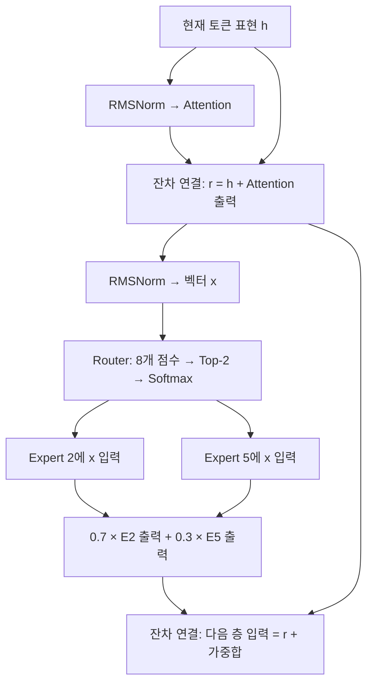

**Q1. Mixtral 8×7B는 7B expert가 8개라는 뜻인가? 그러면 총 56B인가?**

**A. 총 파라미터는 약 46.7B다. 7B 모델 전체를 8개 넣은 구조가 아니라, 각 Transformer 층의 FFN을 8개로 늘린 구조이기 때문이다.**

Attention과 임베딩 등은 expert들이 공유하므로, `7B × 8`로 계산하면 공유 부분을 중복해서 세게 된다. 이름의 ‘8×7B’는 전체 파라미터 수를 그대로 곱하라는 의미가 아니다.

정확히 말하면 **expert 하나는 한 층 안에 있는 FFN 하나**다. Mixtral은 32개 층 각각에 expert 8개를 둔다. 따라서 FFN 블록은 총 256개이며, 각각이 7B인 것은 아니다. [mistral.ai](https://mistral.ai/news/mixtral-of-experts/?utm_source=chatgpt.com)

---

**Q2. Sparse Mixture of Experts는 그냥 MoE와 무엇이 다른가? MoE는 원래 sparse한 것 아닌가?**

**A. MoE는 여러 expert의 출력을 조합하는 넓은 개념이고, Sparse MoE는 그중 일부 expert만 실행하는 방식이다.**

| 구분 | 토큰 하나를 처리하는 방식 |
|---|---|
| Dense MoE | 모든 expert를 실행하고 출력을 가중합 |
| Sparse MoE | 일부 expert만 선택해 실행하고 출력을 가중합 |
| Mixtral | 8개 중 2개 선택 |
| Switch Transformer | 여러 expert 중 1개 선택 |

최근 LLM 문맥에서는 Sparse MoE를 줄여서 ‘MoE’라고 부르는 경우가 많다.

여기서 **sparse하다는 것은 expert 내부의 가중치가 대부분 0이라는 뜻이 아니라, 토큰마다 실행하는 expert가 일부라는 뜻**이다.

---

**Q3. Transformer에서 FFN의 역할은 비선형 변환이 맞나?**

**A. 맞다. 각 토큰의 표현에 비선형 변환을 적용해, 그 안에 담긴 특징들을 조합하고 다음 층에서 사용할 표현으로 바꾸는 역할이다.**

Attention을 거쳐 어떤 토큰의 벡터에 ‘은행이라는 단어’, ‘돈에 관한 문맥’ 등의 정보가 들어왔다고 하자. FFN은 이런 특징의 조합에 따라 특정 특징을 강화하거나 약화하는 함수를 학습할 수 있다. 이는 역할을 설명하는 예시이며, 특정 차원에 이런 의미가 하나씩 배정된다는 뜻은 아니다.

**비선형 변환이 필요한 이유는, 선형 변환만 연속해서 적용하면 결국 하나의 선형 변환으로 합쳐지기 때문이다.** 비선형성이 있어야 입력 특징의 조합에 따라 서로 다른 반응을 하는 복잡한 함수를 표현할 수 있다.

Mixtral의 expert FFN은 SwiGLU 방식이다. 입력을 두 갈래로 변환하고, 한쪽에 비선형 함수인 SiLU를 적용한 뒤 두 결과를 원소별로 곱한다.

\[
E_i(x)=W_{2,i}\left[\operatorname{SiLU}(W_{1,i}x)\odot(W_{3,i}x)\right]
\]

이 계산은 **토큰마다 따로 적용**된다. 다만 입력 벡터 \(x\)에는 앞선 Attention을 통해 다른 토큰의 정보가 이미 반영되어 있다.

---

**Q4. 토큰마다 router가 두 expert를 선택하고 출력을 합치는 파이프라인은 실제로 어떻게 작동하나?**

**A. 현재 토큰의 벡터로 expert 8개의 점수를 계산하고, 상위 2개의 FFN에 같은 벡터를 넣은 다음, 두 출력 벡터를 가중합한다.**

아래는 **한 Transformer 층에서 토큰 하나를 처리하는 과정**이다. Expert 번호와 가중치는 설명용 예시다.



Mixtral에서는 \(x\)가 4,096차원이고, router는 이를 8개 점수로 바꾸는 작은 선형층이다. 각 expert는 4,096차원 입력을 내부적으로 14,336차원으로 확장해 처리하고, 다시 4,096차원으로 돌려준다.

다음은 **논문의 연산을 풀어 쓴 PyTorch식 의사코드**다. 실제 배치 처리 최적화는 생략했다.

```python
# x: 한 토큰의 현재 표현, shape [4096]
scores = router(x)                    # [8]
top_scores, ids = scores.topk(k=2)     # 각각 [2]
weights = softmax(top_scores, dim=-1)  # 예: [0.7, 0.3]

# 선택한 두 expert에 같은 x를 넣는다.
out_0 = experts[ids[0]](x)             # [4096]
out_1 = experts[ids[1]](x)             # [4096]

y = weights[0] * out_0 + weights[1] * out_1
```

**Expert 2의 출력이 expert 5로 들어가는 순차 실행이 아니다.** 둘 다 같은 입력을 처리하고 결과를 합친다. 선택되지 않은 나머지 6개 FFN은 그 토큰에 대해 실행하지 않는다.

실제 구현에서는 토큰을 하나씩 반복 처리하기보다, **같은 expert로 배정된 토큰들을 모아 행렬 연산**한다.

---

**Q5. “The selected experts can be different at each timestep”은 무슨 뜻인가?**

**A. 생성 과정에서 다음 토큰을 처리할 때, 이전 토큰과 다른 expert 두 개가 선택될 수 있다는 뜻이다.**

같은 층에서도 다음처럼 달라질 수 있다.

| 처리 중인 토큰 | 선택된 expert — 설명용 예시 |
|---|---|
| `나는` | 2, 5 |
| `오늘` | 1, 5 |
| `학교에` | 3, 7 |

또한 **같은 토큰도 층마다 다른 expert를 통과할 수 있다.** 각 층에 별도의 router와 expert들이 있고, 층을 지날 때마다 토큰의 표현도 바뀌기 때문이다.

문장 전체에 사용할 expert 두 개를 처음에 고정하는 구조가 아니다.

---

**Q6. 두 expert를 사용하면 7B×2=14B 아닌가? 왜 active parameter가 13B인가?**

**A. 두 expert 경로를 사용해도 공유 Attention·임베딩 등을 두 번 세지 않기 때문이다. 전체 약 46.7B 중 토큰당 활성 파라미터는 약 12.9B다.**

공개 설정을 바탕으로 계산하면, 한 층의 expert 하나는 약 0.176B다.

\[
3\times4096\times14336 \approx 0.176B
\]

여기서 3은 SwiGLU의 세 가중치 행렬에 해당한다. 32개 층에서 expert를 하나씩 사용하는 데 필요한 FFN 파라미터 합은 약 5.64B다.

| 구성 | 전체 파라미터 계산 | 토큰당 활성 파라미터 계산 |
|---|---:|---:|
| Attention·임베딩 등 공유 부분 | 약 1.6B | 약 1.6B |
| 32개 층의 expert FFN | 8 × 약 5.64B | 2 × 약 5.64B |
| 합계 | **약 46.7B** | **약 12.9B** |

위 분해는 공개 구조에서 계산한 근삿값이다. [mistral.ai](https://mistral.ai/news/mixtral-of-experts/?utm_source=chatgpt.com)

**‘토큰당 13B 활성’과 ‘모델을 저장하는 데 13B만 필요’는 다르다.** 다른 토큰이 다른 expert를 선택할 수 있으므로 전체 가중치를 보관해야 한다.

---

**Q7. “Human benchmark”는 사람이 평가했다는 뜻인가?**

**A. 여기서는 맞다. 논문이 말하는 human evaluation은 LMSYS Chatbot Arena에서 사람이 두 모델의 답변을 비교한 평가다.**

평가자는 모델 이름이 가려진 상태에서 두 답변을 보고 더 선호하는 답변에 투표한다. 그 결과를 모아 상대적 순위를 계산한다.

따라서 **‘사람보다 잘했다’는 뜻이 아니라 ‘사람들이 다른 모델의 답변보다 더 선호했다’는 뜻**이다. [lmsys.org](https://www.lmsys.org/blog/2023-05-03-arena/?utm_source=chatgpt.com)

함께 등장하는 평가들은 구분해야 한다.

| 평가 | 무엇을 평가하나? | 판정 방식 |
|---|---|---|
| Chatbot Arena | 실제 사용자가 느끼는 답변 선호도 | 사람의 비교 투표 |
| MT-Bench | 정해진 다중 턴 질문에 대한 응답 품질 | 대표적으로 GPT-4를 심사자로 사용 |
| HumanEval | 생성한 코드의 정답 여부 | 테스트 코드 실행 |

MT-Bench의 LLM 평가와 Arena의 사람 평가는 서로 다르다. [arxiv.org](https://arxiv.org/abs/2306.05685?utm_source=chatgpt.com)

Mixtral 논문의 MT-Bench 결과는 **Mixtral-Instruct 8.30, GPT-3.5-Turbo-1106 8.32**로, 여기서는 앞선 것이 아니라 비슷했다. “GPT-3.5 등을 넘었다”는 문장은 Arena 결과와 연결해 읽어야 한다. [arxiv.org](https://arxiv.org/html/2401.04088v1?utm_source=chatgpt.com)

---

**Q8. 그때는 오픈 모델이 클로즈드 모델을 넘었는데, 지금은 왜 안 되는가? 가장 큰 요인은 GPU와 모델 크기인가?**

**A. 이 결과는 ‘당시 오픈 모델이 모든 최상위 클로즈드 모델을 넘었다’는 뜻은 아니다. 성능 차이를 GPU 수와 모델 크기만으로 설명할 수도 없다.**

Mixtral이 제시한 것은 특정 비교 모델과 평가에서의 우위다. **GPT-3.5를 넘었다는 사실만으로 GPT-4까지 넘었다고 해석할 수는 없다.**

이후에도 공개 가중치 모델이 강한 비공개 모델에 근접한 사례는 있다. DeepSeek-R1은 2025년 보고서에서 추론 과제 성능이 OpenAI o1-1217과 비슷하다고 보고했다. 따라서 ‘오픈 모델은 이제 못 넘는다’는 일반화도 어렵다. 이것이 현재의 전체 순위를 뜻하는 것은 아니다. [arxiv.org](https://arxiv.org/html/2501.12948v1?utm_source=chatgpt.com)

격차의 원인을 하나로 확정할 공개 근거는 부족하지만, 기술적으로는 다음을 함께 봐야 한다.

| 요인 | 성능에 영향을 주는 이유 |
|---|---|
| 학습 연산량·GPU 인프라 | 더 많은 데이터 학습과 대규모 실험, 반복 개선을 가능하게 함 |
| 모델 규모·구조 | 학습할 수 있는 함수의 용량과 연산 효율에 영향 |
| 데이터 품질·구성 | 어떤 지식과 문제 해결 패턴을 얼마나 배우는지 결정 |
| 후학습·강화학습 | 이미 가진 능력을 지시 수행과 문제 해결에 활용하도록 개선 |
| 추론 시 연산량 | 더 길게 추론하거나 여러 후보를 검증할 여지를 제공 |

특히 같은 기반 모델에서도 강화학습과 후학습 방식에 따라 추론 성능이 달라질 수 있다. **GPU는 중요한 기반이지만, 그 자원을 어떤 데이터·학습 방법·실험에 쓰느냐까지 합쳐서 성능이 결정된다.**

---

**Q9. Apache 2.0은 어떤 라이선스인가? 특징은?**

**A. 상업적 사용·수정·재배포를 허용하고, 수정한 코드를 반드시 공개할 의무도 없는 허용적인 라이선스다.**

재배포할 때 라이선스와 필요한 저작권·NOTICE 고지를 유지하고 변경 사실을 표시해야 한다. 기여자의 관련 특허 사용 허락도 포함하지만, 상표 사용 권한까지 주지는 않는다. [apache.org](https://apache.org/licenses/LICENSE-2.0.html?utm_source=chatgpt.com)

---

**Q10. 왜 “작은 batch에서는 빠른 inference”, “큰 batch에서는 높은 throughput”이라고 구분하는가? Batch size 조건이 붙는 이유와 원리는?**

**A. 작은 batch에서는 ‘개별 요청이 얼마나 빨리 응답하는가’, 큰 batch에서는 ‘서버가 전체 요청을 얼마나 많이 처리하는가’가 중요하고, 속도를 제한하는 원인도 달라지기 때문이다.**

우선 지표를 구분하면 다음과 같다.

| 지표 | 의미 | 설명용 예시 |
|---|---|---|
| Latency | 한 요청의 처리에 걸리는 시간 | 내 다음 토큰이 나올 때까지 20ms |
| Throughput | 전체 요청을 합쳐 단위 시간에 처리하는 양 | 서버 전체에서 초당 2,000토큰 생성 |

아래는 **출력 토큰을 한 개씩 생성하는 decode 단계**를 중심으로 한 설명이다.

**① 작은 batch: 가중치를 읽어 오는 비용이 중요하다.**

동시에 처리하는 요청이 하나라면, 다음 토큰 하나를 계산하기 위해 큰 가중치 행렬들을 GPU 메모리에서 읽어야 한다. 계산 장치는 빠른데 데이터를 공급하는 속도가 따라가지 못하는 **메모리 대역폭 병목**이 생기기 쉽다.

Mixtral은 해당 토큰에 선택된 두 expert만 실행하므로, 모든 expert를 실행하는 경우보다 읽을 가중치와 계산량이 적다. 이것이 개별 토큰의 생성 시간을 줄이는 데 도움이 된다.

**② 큰 batch: 가중치를 여러 토큰에 재사용할 수 있다.**

같은 expert에 배정된 토큰이 많으면 그 expert의 가중치를 이용해 여러 토큰을 한꺼번에 행렬 연산한다. 가중치를 읽는 비용을 여러 토큰이 나누어 부담하고 GPU의 계산 장치도 더 잘 활용한다.

충분히 큰 batch에서는 연산량 자체가 더 중요한 병목이 될 수 있다. [developer.nvidia.com](https://developer.nvidia.com/blog/mastering-llm-techniques-inference-optimization?utm_source=chatgpt.com)

Mixtral은 여전히 **각 토큰이 두 expert만 계산**하므로, 비슷한 성능의 큰 dense 모델보다 같은 연산 자원으로 더 많은 토큰을 처리할 여지가 있다.

예를 들어 batch에 토큰 100개가 있다고 하자.

- Mixtral: `100개 × 2 expert = 200회`의 토큰–expert 처리
- 모든 expert를 실행한다면: `100개 × 8 expert = 800회`

**Batch 전체에서 expert 8개가 모두 사용되더라도, 토큰마다 8개를 모두 실행하는 것은 아니다.**

따라서 저 문장은 “작은 batch에서만 빠르다”는 조건이 아니라, **적은 요청을 처리할 때와 많은 요청을 처리할 때의 이점을 각각 표현한 것**이다.

실제 속도는 라우팅·GPU 간 통신·KV cache 등에 좌우되므로 활성 파라미터 비율만큼 그대로 빨라지지는 않는다.

---

**Q11. 모든 FFN 자리에 FFN 8개가 있는 것인가? Expert는 층마다 별도로 존재하는가?**

**A. 맞다. Mixtral에서는 각 Transformer 층의 FFN 하나를, 별도의 FFN 8개와 router로 구성한 MoE 블록으로 바꾼다.**

| 위치 | 구성 |
|---|---|
| 1층 | Attention + Router₁ + Expert₁,₁ … Expert₁,₈ |
| 2층 | Attention + Router₂ + Expert₂,₁ … Expert₂,₈ |
| … | … |
| 32층 | Attention + Router₃₂ + Expert₃₂,₁ … Expert₃₂,₈ |

**1층의 expert 1과 2층의 expert 1은 서로 다른 가중치를 가진 별도 FFN**이다. 전체에 expert 8개만 두고 모든 층이 공유하는 방식이 아니다.

---

**Q12. “Combine their outputs additively”는 무슨 뜻인가?**

**A. ‘출력들을 더해서 결합한다’는 뜻이다. Mixtral에서는 router 가중치를 곱한 뒤 더하는 가중합이다.**

예를 들어 expert 2와 5가 선택되고 가중치가 각각 0.7, 0.3이라면 다음과 같다.

\[
y=0.7E_2(x)+0.3E_5(x)
\]

두 expert의 출력 벡터는 크기가 같으므로, 각 차원끼리 더해서 하나의 출력 벡터를 만든다. 두 벡터를 이어 붙여 차원을 늘리는 concatenation은 아니다.

---

**Q13. 파라미터 수를 늘리면서 비용과 지연을 억제할 수 있는 이유는?**

**A. 보유한 expert 수와 토큰마다 실행하는 expert 수를 따로 정할 수 있기 때문이다.**

Expert를 8개에서 16개로 늘려도 토큰마다 2개만 선택하면, **FFN 가중치의 총량은 두 배가 되지만 토큰당 실행하는 FFN 수는 그대로 2개**다.

다만 모델 저장 메모리는 늘고, router 크기나 통신 비용도 달라질 수 있다. 따라서 “비용이 전혀 늘지 않는다”가 아니라 **전체 파라미터를 늘리는 것에 비해 토큰당 연산량 증가를 억제한다**는 의미다.

---

**Q14. Mixtral이 decoder-only라는 것은 무슨 뜻인가?**

**A. 별도의 encoder 없이, 앞선 토큰들을 참고해 다음 토큰을 예측하는 Transformer 구조라는 뜻이다.**

질문이나 문서를 별도 encoder가 읽고 decoder에 넘기는 구조가 아니다. **입력 문장도 같은 decoder가 처리**하고, 그 뒤에 이어질 출력 토큰을 생성한다.

여기서 decoder라는 이름이 붙었다고 해서 출력 문장만 처리하는 것은 아니다.

---

**Q15. 어차피 next-token prediction인데, 사전학습의 context size가 왜 중요한가? 입력은 마스킹하고 답만 예측하는가?**

**A. 다음 토큰을 예측한다는 목표와, 그 예측을 위해 얼마나 긴 앞부분을 볼 수 있는지는 별개다. 일반적인 사전학습은 ‘질문을 제외하고 답만 학습’하는 방식이 아니다.**

예를 들어 다음 문서가 있다고 하자.

> 문서 앞부분: “프로젝트 암호는 사과다.”  
> … 매우 긴 내용 …  
> 문서 뒷부분: “앞에서 정한 프로젝트 암호는 사과다.”

마지막 `사과`를 예측할 때 앞부분이 학습 문맥 안에 있어야 그 정보를 참고하는 방법을 배울 기회가 생긴다. 문맥을 짧게 잘라 앞부분이 빠졌다면 해당 학습 예시에서 그 관계를 배울 수 없다.

일반적인 causal language modeling은 **각 위치에서 다음 토큰을 예측**한다.

| 해당 위치에서 볼 수 있는 내용 | 예측할 토큰 |
|---|---|
| `나는` | `오늘` |
| `나는 오늘` | `학교에` |
| `나는 오늘 학교에` | `갔다` |

학습에서는 이를 **한 번의 forward에서 병렬로 계산**한다. 대신 각 위치가 미래 정답을 훔쳐보지 못하도록 causal attention mask를 사용한다.

여기서 두 가지 마스킹을 구분해야 한다.

| 구분 | 무엇을 막는가? | 입력 정보는 볼 수 있는가? |
|---|---|---|
| **Causal attention mask** | 현재 위치가 미래 토큰을 보는 것 | 이전 토큰은 볼 수 있음 |
| **Prompt loss mask** | 질문·문서 부분의 예측 오차를 loss에 포함하는 것 | 질문·문서는 그대로 볼 수 있음 |

**“입력은 마스킹하고 답만 NTP”는 두 번째 방식**, 즉 응답 부분에만 loss를 주는 SFT에 가깝다. 입력 문서를 가려 버리는 것이 아니다. 이런 completion-only 학습은 실제 SFT 구현에서도 지원한다. [huggingface.co](https://huggingface.co/docs/trl/v0.23.0/sft_trainer?utm_source=chatgpt.com)

또한 **32K로 학습했다고 모든 토큰이 32K의 앞 문맥을 보는 것도 아니다.** 시퀀스 앞쪽 토큰은 볼 수 있는 앞부분이 짧다. 길게 넣는 것과 먼 근거를 활용하도록 학습시키는 것은 구분해야 한다.

---

**Q16. Figure 1에서 gating weights를 expert 뒤로 넘기는 선은 residual connection인가? 왜 필요한가?**

**A. Residual이 아니라, expert 출력을 얼마나 반영할지 결정하는 가중치를 전달하는 선이다.**

Router는 두 가지를 결정한다.

1. **어떤 expert를 실행할 것인가?** → 예: expert 2와 5
2. **각 expert의 출력을 얼마나 반영할 것인가?** → 예: 0.7과 0.3

따라서 expert 계산이 끝난 뒤에도 그 가중치가 필요하다.

\[
\underbrace{y=0.7E_2(x)+0.3E_5(x)}_{\text{MoE 출력}}
\]

반면 residual connection은 원래 표현을 출력에 더하는 별도의 연산이다.

\[
\underbrace{
h_{\text{out}}
=
h_{\text{in}}
+
\operatorname{MoE}(\operatorname{Norm}(h_{\text{in}}))
}_{\text{FFN 부분의 residual}}
\]

즉, 그림의 선은 **입력 표현을 우회시켜 더하는 경로가 아니라, 출력에 곱할 계수를 운반하는 경로**다.

---

**Q17. 32K에서 정보를 찾는다는 것은 LC 능력을 강조하는 것인가? Sequence length와 location은 각각 무엇인가?**

**A. 맞다. 다만 입증한 것은 주로 ‘긴 입력에 숨겨 놓은 특정 정보를 찾는 능력’이며, 긴 문서의 모든 내용을 종합적으로 이해한다는 뜻은 아니다.**

Mixtral은 긴 텍스트에 암호를 삽입하고 이를 찾게 하는 **passkey retrieval** 평가에서, 시험한 길이와 삽입 위치 전반에 걸쳐 100% 정확도를 보고했다. [arxiv.org](https://arxiv.org/html/2401.04088v1?utm_source=chatgpt.com)

- **Sequence length:** 입력 전체가 얼마나 긴가?
- **Location of the information:** 찾을 정보가 입력의 앞·중간·뒤 중 어디에 있는가?

예를 들어 8K, 16K, 32K 길이의 입력을 만들고, 각각의 앞·중간·뒤에 암호를 넣어도 찾을 수 있는지 평가하는 식이다.

“Regardless of sequence length and location”은 **논문에서 시험한 길이와 위치 안에서 결과가 유지됐다는 뜻**이지, 임의로 더 긴 입력이나 모든 종류의 정보에서도 된다는 뜻은 아니다.

---

**Q18. Mixtral이 나왔을 때 Lost in the Middle은 이미 발표된 상태였나?**

**A. 그렇다. Lost in the Middle의 최초 공개는 2023년 7월이고, Mixtral 모델 공개는 2023년 12월, 논문은 2024년 1월이다.**

Lost in the Middle은 필요한 정보가 입력의 앞이나 뒤에 있을 때보다 **중간에 있을 때 성능이 떨어지는 현상**을 보고했다. [arxiv.org](https://arxiv.org/abs/2307.03172?utm_source=chatgpt.com)

Mixtral의 위치별 passkey retrieval 평가는 이 문제와 관련이 있지만, **단순 암호 검색을 통과했다고 다문서 QA에서도 위치 편향이 사라졌다고 볼 수는 없다.**

---

**Q19. 당시 최대 문맥은 보통 얼마였나? 32K는 혁신적이었나?**

**A. 오픈 모델의 대표적인 기본 문맥보다 길었지만, 업계 최초이거나 가장 긴 문맥은 아니었다.**

| 모델 | 당시 문맥 길이 |
|---|---:|
| Llama 2 — 2023년 7월 | 4K |
| Mixtral — 2023년 12월 | 32K |
| Claude 2.1 — 2023년 11월 | 200K |

Llama 2는 4,096토큰, Claude 2.1은 이미 200K를 지원했다. 당시에도 모델마다 차이가 컸으므로 하나의 ‘보통 최대 길이’로 묶기 어렵다. [arxiv.org](https://arxiv.org/pdf/2307.09288?utm_source=chatgpt.com)

Mixtral의 의미는 **최장 문맥 기록보다는, 공개 가중치 모델에서 32K와 높은 성능·효율을 함께 제공했다는 것**에 가깝다.

또한 context window는 대체로 **입력과 생성 중인 출력을 합쳐 모델이 다루는 문맥 한도**를 말한다. 최대 출력 길이와는 다른 개념이다.

---

**Q20. 지금은 어떻게 입력 토큰 수, 즉 context window를 훨씬 크게 늘렸나?**

**A. 위치 표현 조정, 긴 문맥을 이용한 추가 학습, 메모리·연산 최적화를 함께 발전시켰다.**

문맥 확장에는 서로 다른 문제 세 개를 해결해야 한다.

| 문제 | 대표적인 해결 방향 |
|---|---|
| 학습 때보다 먼 토큰 위치를 어떻게 표현할까? | RoPE 조정, positional interpolation 등 |
| 먼 곳의 정보를 활용하는 방법을 어떻게 배울까? | 긴 시퀀스로 추가 학습하고, 긴 근거가 필요한 과제 제공 |
| 긴 입력을 GPU 메모리와 시간 안에 어떻게 처리할까? | FlashAttention, 병렬화, KV cache 관리, 일부 모델의 sparse attention |

**Positional interpolation**은 위치 표현을 조정해 기존 모델의 문맥을 확장하는 방법이다. 단순히 설정 파일의 최대 길이 숫자만 바꾸는 것과 다르다. [arxiv.org](https://arxiv.org/abs/2306.15595?utm_source=chatgpt.com)

**FlashAttention**은 attention 계산의 메모리 입출력을 줄여 긴 시퀀스를 더 효율적으로 처리한다. 다만 **FlashAttention 자체가 dense attention의 연산량을 선형으로 바꾸는 것은 아니다.** [arxiv.org](https://arxiv.org/abs/2205.14135?utm_source=chatgpt.com)

따라서 문맥을 늘린다는 것은 ‘더 긴 입력이 들어가도록 만드는 것’과 ‘그 입력을 실제로 잘 활용하도록 학습하는 것’을 함께 해결하는 과정이다.

---

**Q21. Lost in the Middle은 지금 어느 정도 해결되었나?**

**A. 긴 문맥 활용 능력은 개선됐지만, 위치 편향과 긴 입력에서의 성능 저하가 완전히 해결됐다고 볼 수는 없다. 평가 과제와 모델별로 봐야 한다.**

앞서 확인한 사례는 다음과 같다.

- **2026년 사례:** Anthropic은 Opus 4.6의 1M 문맥 MRCR v2 점수로 78.3%를 보고했다. 백만 토큰 규모에서도 정보를 활용할 수 있다는 근거지만, 제조사 평가이며 모든 긴 문서 과제를 대표하지 않는다. [claude.com](https://claude.com/resources/articles/1m-context-ga?utm_source=chatgpt.com)
- **더 어려운 검색의 사례:** NoLiMa는 질문과 근거에 같은 단어가 직접 반복되지 않도록 평가했다. 2025년 논문에서는 GPT-4o도 짧은 문맥 99.3%에서 32K 문맥 69.7%로 하락했다. 이 수치를 최신 모델 성능으로 읽어서는 안 되지만, 단순 암호 검색만으로 LC 능력을 판단하기 어렵다는 근거다. [proceedings.mlr.press](https://proceedings.mlr.press/v267/modarressi25a.html?utm_source=chatgpt.com)

특히 **입력이 길어져 성능이 떨어지는 현상 전체와, 중간 위치에서 특히 성능이 떨어지는 Lost in the Middle은 동일하지 않다.**

후자의 해결 정도를 확인하려면 **같은 문항에서 근거 위치만 앞·중간·뒤로 옮겨 성능을 비교**해야 한다.

---

**Q22. Mixtral-Instruct의 SFT와 DPO는 구현 수준에서 어떻게 진행되는가?**

**A. 먼저 SFT로 좋은 답변을 따라 쓰게 학습하고, 그 체크포인트에서 DPO로 선호 답변이 비선호 답변보다 상대적으로 더 높은 확률을 갖도록 학습한다.**

Mixtral 논문은 SFT 다음 DPO를 사용했다고 밝히지만, 데이터와 학습 설정을 재현에 충분할 만큼 공개하지는 않는다. **아래는 표준적인 구현 설명이며, Mixtral의 공개되지 않은 세부 설정을 재구성한 것은 아니다.**

**① SFT: 질문과 모범 답변으로 학습**

예시 데이터:

```text
질문: MoE가 연산량을 줄이는 이유를 설명해 줘.
답변: 각 토큰이 전체 expert 중 일부만 실행하기 때문이다.
```

질문과 답변을 이어 붙이고, 답변 토큰의 next-token prediction loss를 계산한다.

```python
# 개념적 예시:
# causal-LM 구현이 내부에서 label을 한 칸 shift한다고 가정
input_ids = tokenize(prompt + answer)
labels = input_ids.clone()
labels[:prompt_length] = -100  # 질문 부분은 loss에서 제외

loss = model(input_ids=input_ids, labels=labels).loss
loss.backward()
optimizer.step()
```

답변의 두 번째 토큰은 질문과 **정답 답변의 첫 번째 토큰**을 보고 예측한다. 학습 중 매번 답변을 자유 생성한 뒤 채점하는 방식이 아니다.

질문 부분은 loss에서 제외하더라도, 답변을 예측하는 데 필요한 입력으로 그대로 사용한다. [huggingface.co](https://huggingface.co/docs/trl/v0.23.0/sft_trainer?utm_source=chatgpt.com)

**② DPO: 같은 질문에 대한 선호·비선호 답변 쌍으로 학습**

```text
prompt:
MoE가 연산량을 줄이는 이유는?

chosen:
각 토큰이 전체 expert 중 일부만 실행하기 때문이다.

rejected:
모든 expert를 실행하지만 가중치를 저장하지 않기 때문이다.
```

보통 SFT 모델로 다음 두 역할을 시작한다.

| 모델 | 역할 |
|---|---|
| 학습 모델 — policy | 가중치를 업데이트 |
| 기준 모델 — reference | SFT 시점의 가중치를 고정 |

두 모델에서 chosen과 rejected 각각의 **답변 토큰 로그확률 합**을 구한다. 질문 토큰 자체의 로그확률은 합에서 제외한다.

```python
policy_gap = logp_policy_chosen - logp_policy_rejected
ref_gap = logp_ref_chosen - logp_ref_rejected

loss = -logsigmoid(beta * (policy_gap - ref_gap)).mean()
loss.backward()
optimizer.step()  # policy만 업데이트
```

이는 **기준 모델보다 chosen 대 rejected의 상대적 선호를 더 강화**하는 목적이다.

별도 보상 모델을 훈련하거나, 매 학습 단계에서 답변을 새로 생성할 필요가 없다. 준비된 두 답변을 입력해 확률을 계산하고 학습 모델만 업데이트한다. [arxiv.org](https://arxiv.org/html/2305.18290v2?utm_source=chatgpt.com)

---

**Q23. “Balanced sentiment profile”은 무슨 뜻인가?**

**A. 서로 다른 사회적 집단을 언급할 때 생성되는 문장의 긍정·부정적 어조가 특정 집단에 치우치지 않는다는 뜻이다.**

다음은 설명용 예시다.

| 집단 | 생성 문장의 평균 감성 점수 |
|---|---:|
| A | +0.8 |
| B | −0.5 |

이처럼 차이가 크다면 한 집단에는 호의적이고 다른 집단에는 부정적으로 묘사하는 경향을 의심할 수 있다. **Sentiment profile은 이런 감성 점수들의 분포나 양상**이다.

다만 다음은 서로 다른 주장이다.

- **더 긍정적:** 평균 감성 점수가 높다.
- **더 균형적:** 비교하는 집단 사이의 감성 차이가 작다.
- **편향이 없다:** 위 두 조건만으로 입증할 수 없다.

원문 소개 문장은 Instruct와 연결돼 보이지만, **§3.3에서는 base model을 평가했다고 명시**한다. BOLD 결과도 모든 항목의 분산이 감소한 것은 아니다.

따라서 “SFT·DPO 덕분에 모든 편향이 줄었다”거나 “긍정적인 문장을 더 생성하므로 편향이 없다”고 해석하면 안 된다. [arxiv.org](https://arxiv.org/html/2401.04088v1?utm_source=chatgpt.com)

---

**Q24. MegaBlocks, CUDA kernel, vLLM에 통합한다는 것은 각각 무슨 뜻인가?**

**A. MoE 계산을 GPU에서 효율적으로 실행하도록 만든 기술을 vLLM의 모델 실행 코드에 연결한다는 뜻이다.**

| 용어 | 역할 |
|---|---|
| **vLLM** | 모델을 로드하고 요청을 묶어 처리하며 토큰을 생성하는 추론·서빙 엔진 |
| **CUDA kernel** | NVIDIA GPU에서 많은 스레드가 병렬로 실행하는 계산 함수 |
| **MegaBlocks** | MoE의 불규칙한 토큰 배정을 효율적으로 처리하도록 설계된 시스템 |

MoE에서는 expert별로 배정되는 토큰 수가 다르다.

| Expert | 배정된 토큰 수 — 설명용 예시 |
|---|---:|
| Expert 1 | 40 |
| Expert 2 | 3 |
| Expert 3 | 17 |

모든 expert의 입력 크기를 40개로 맞추면 빈칸을 채우는 **padding 연산이 낭비**된다. 반대로 정해진 용량을 넘는 토큰을 버리면 학습에 손해가 생긴다.

MegaBlocks는 이를 **블록 단위 희소 행렬 연산**으로 구성해, 필요 없는 부분을 많이 계산하지 않으면서 GPU를 효율적으로 활용한다.

원래 MegaBlocks 논문은 MoE 학습 시스템을 다루며, Mixtral 논문은 관련 커널의 추론 활용을 언급한다. [arxiv.org](https://arxiv.org/abs/2211.15841?utm_source=chatgpt.com)

즉, “vLLM에 통합한다”는 것은 vLLM이 Mixtral의 MoE 계산을 실행할 때 이런 최적화된 연산을 사용할 수 있도록 구현을 연결한다는 뜻이다.

---

**Q25. “Submitted changes to the vLLM project”는 무엇을 했다는 뜻이며, 어떻게 하는가?**

**A. vLLM의 코드를 수정하고, 그 수정 사항을 공식 프로젝트에 반영해 달라고 기여했다는 뜻이다. 보통 GitHub의 Pull Request(PR)를 통해 진행한다.**

일반적인 개발 과정은 다음과 같다.

1. Mixtral 가중치를 읽고 모델 구조를 실행하는 코드를 추가한다.
2. MoE 계산이 최적화된 GPU 커널을 호출하도록 연결한다.
3. 출력 정확성과 실행 성능을 확인한다.
4. GitHub에 PR을 올려 변경 반영을 요청한다.
5. 프로젝트 관리자의 검토와 수정을 거쳐 병합되면 공식 코드에 포함된다.

위 목록은 일반적인 기여 과정 설명이다. 논문 문장만으로 당시 PR에서 정확히 어떤 파일을 수정했는지까지 알 수는 없다.

**Submitted는 변경 사항을 ‘제출했다’는 뜻이지, 그 단어 자체가 병합 완료를 뜻하는 것은 아니다.**

---

**Q26. SkyPilot은 무엇인가? “클라우드의 어떤 인스턴스에도 vLLM endpoint를 배포할 수 있다”는 무슨 뜻인가?**

**A. SkyPilot은 클라우드의 계산 자원을 마련하고 작업을 실행·관리하는 도구이고, 이 문장은 ‘클라우드 GPU 서버에 vLLM을 켜서 API로 호출할 수 있게 한다’는 뜻이다.**

| 표현 | 의미 |
|---|---|
| Cloud instance | 클라우드에서 빌린 서버 한 대 |
| vLLM server | 그 서버에서 모델을 실행하며 요청을 받는 프로그램 |
| Endpoint | 다른 프로그램이 요청을 보낼 API 주소 |
| SkyPilot | 서버 준비·환경 설치·실행 등을 자동화하는 도구 |

“GPU 서버를 준비하고, Mixtral을 vLLM으로 실행해 줘”라는 설정을 작성하면 SkyPilot이 해당 환경을 마련하고 실행하도록 돕는다.

이후 내 Python 프로그램은 endpoint로 프롬프트를 보내고 답변을 받는다.

**vLLM은 모델 실행 담당, SkyPilot은 그 실행 환경의 배포·관리 담당**으로 구분하면 된다. 공식 연동 문서도 단일 인스턴스 실행과 여러 복제본을 이용한 서빙을 설명한다. [docs.vllm.ai](https://docs.vllm.ai/en/stable/deployment/frameworks/skypilot/?utm_source=chatgpt.com)

“Any instance”는 문자 그대로 아무 서버에서나 된다는 뜻은 아니다. 지원되는 환경이고, 모델을 실행할 GPU 메모리 등의 자원이 충분해야 한다.